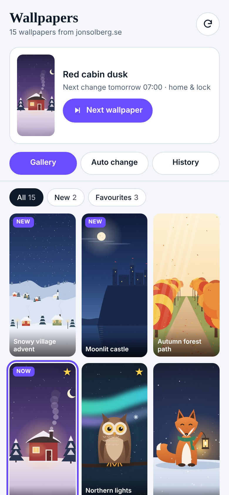
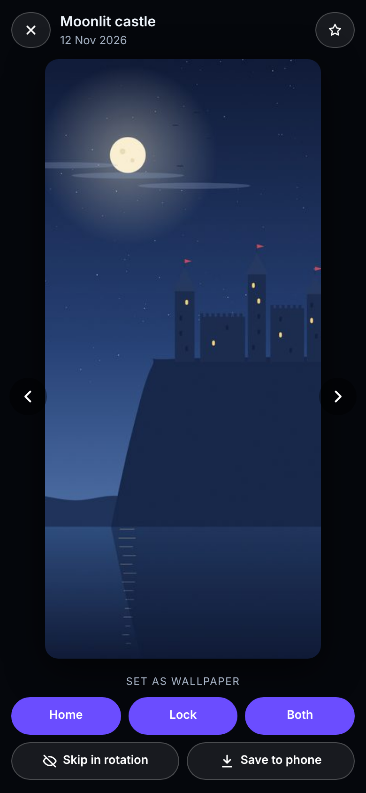
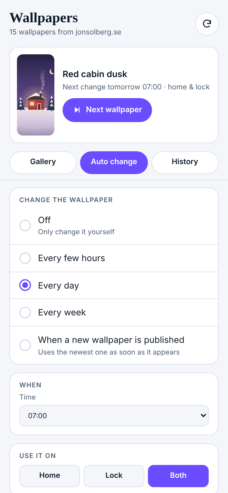

# Wallpapers from jonsolberg.se

Apps that change your wallpaper to the free, original wallpapers published on
[jonsolberg.se](https://jonsolberg.se:8080/Pictures/) – a new picture every few hours, every day,
every week, or as soon as a new one is published. Each app picks the picture size that fits the screen.

<p align="center">
  
  
  
</p>

| Platform | Folder | What it is |
|---|---|---|
| Android 10+ | [`android/`](android) | Gallery, favourites, automatic change of home and/or lock screen, a "Next wallpaper" shortcut and quick settings tile |
| Linux | [`linux/`](linux) | Tray app for GNOME (Ubuntu), KDE Plasma, Xfce, Cinnamon and MATE, packaged as a `.deb` |
| Windows 10/11 | [`windows/`](windows) | Notification-area app – left-click the icon for the next wallpaper, right-click for the menu with thumbnails – light and dark mode, start with Windows |

## Download

- **Android:** [Wallpapers.apk](https://github.com/jonsolberg/wallpaper/releases/latest/download/Wallpapers.apk).
  To install it, allow your browser or file manager to *install unknown apps* when Android asks.
- **Windows:** [Wallpapers-Windows.exe](https://github.com/jonsolberg/wallpaper/releases/latest/download/Wallpapers-Windows.exe).
  Run it once and it installs itself for your user (no admin rights needed), with a Start menu shortcut, start
  with Windows and an entry in Settings › Apps to uninstall it.
- **Linux:** [jonsolberg-wallpapers_all.deb](https://github.com/jonsolberg/wallpaper/releases/latest/download/jonsolberg-wallpapers_all.deb):

  ```
  sudo apt install ./jonsolberg-wallpapers_all.deb
  ```

All files: [latest release](https://github.com/jonsolberg/wallpaper/releases/latest).

## Building

Every push builds all three apps with GitHub Actions (`.github/workflows/build.yml`) and publishes them as a release.

- **Android:** `cd android && ./gradlew assembleRelease`. Release builds are signed with the key from the
  repository secrets `SIGNING_KEYSTORE_B64`, `SIGNING_STORE_PASSWORD`, `SIGNING_KEY_ALIAS` and `SIGNING_KEY_PASSWORD`;
  without them the APK is debug-signed.
- **Linux:** the `linux/` folder is the package tree; `dpkg-deb --root-owner-group -b linux out.deb` builds it
  (the workflow adds `Installed-Size`).
- **Windows:** `sh windows/build.sh` compiles `Wallpapers-Windows.exe` with Mono's C# compiler (`apt install mono-devel`).
  It runs on the .NET Framework 4 that comes with Windows 10 and 11.

## Support

The apps and wallpapers are free, open source and have no ads. If you enjoy them, you can
[support me on Ko-fi](https://ko-fi.com/jonsolberg) ❤️

[](https://ko-fi.com/jonsolberg)

## License

GNU General Public License v3.0 – see [LICENSE](LICENSE). The wallpapers themselves are © Jon Solberg.
